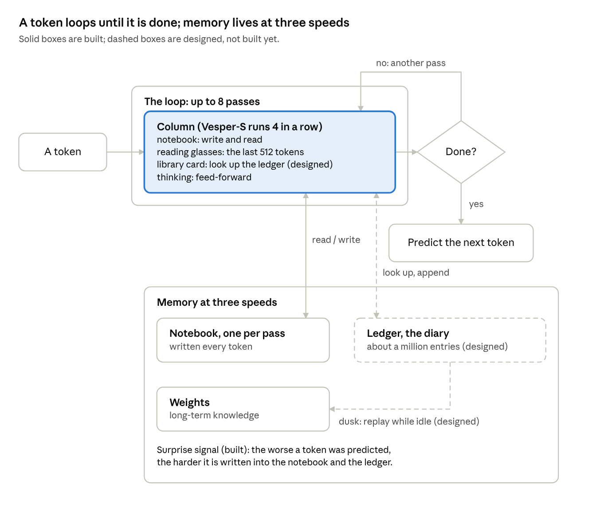
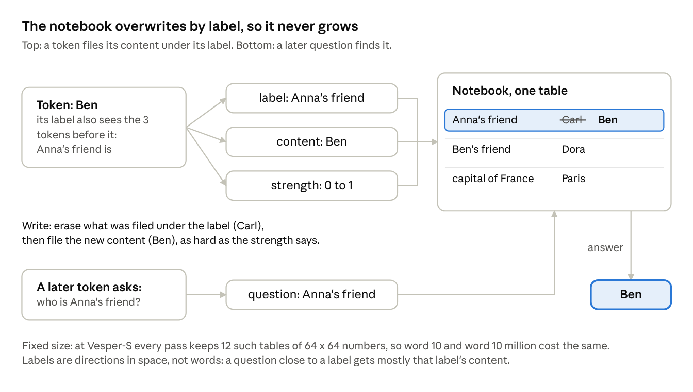
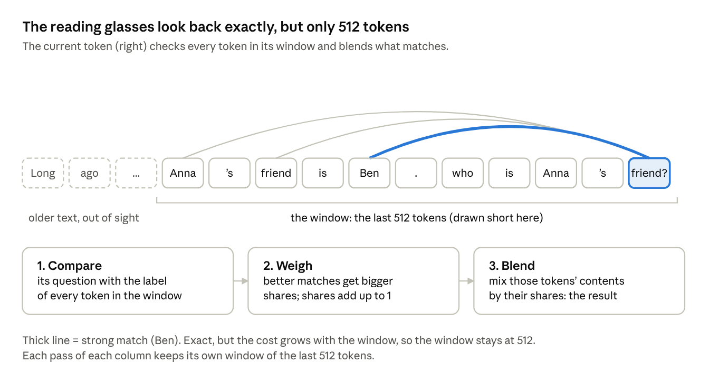
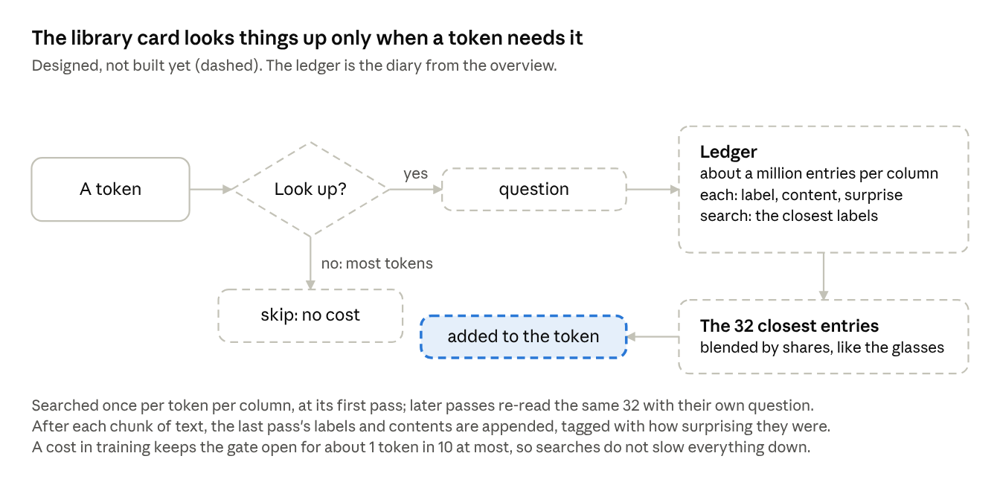
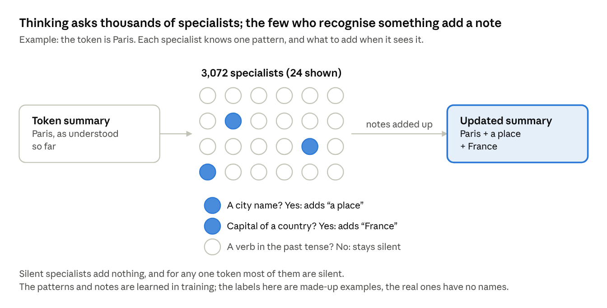

# Vesper, explained

A plain-words tour of the architecture for readers who are not machine-learning specialists.
As of 2026-10-17. The precise design is in [spec.md](spec.md); what is built is in
[registry.md](registry.md).

A normal language model re-reads everything and runs a very tall stack of layers for every word.
Vesper keeps a running memory instead, thinks in loops for as long as each word needs, learns
while it runs, and sleeps to make what it learned permanent.

## What a normal model does

A normal model (a transformer) pays the full price for every word: it re-reads all earlier text
and runs every layer, however easy the word is.

- Text is cut into tokens, roughly word pieces.
- For every new token the model looks back at every earlier token. This is called attention. It
  is precise, but its cost grows with the length of the text, which is why chat models have a
  context window and forget what falls out of it.
- Every token goes once through a stack of maybe 80 layers, whether it is "the" or the crux of a
  maths problem. Same cost either way.
- What it knows lives in two places only: its weights, frozen after training, and the text
  inside the window.

## At a glance

A token goes through the columns, asks "done?", and either loops for another pass or predicts the
next token; every pass reads and writes the notebook, and dusk turns the diary into lasting
weights.

## The pieces

Vesper has one building block, the column, which it runs in a loop. Around it sit a surprise
signal, a diary and a sleep phase.

### 1. The column: the one building block

Think of a person reading a book. The column has four parts:

- **The notebook (recurrent memory, built).** A small table the model writes into as it reads:
  "this key goes with that value". If the key already has an entry, the new value replaces it
  instead of piling up; this is the "delta rule". Writing costs the same at word 10 and at word
  10 million, so length never makes it slower. The notebook is never wiped between chunks of
  text: it is the session's memory.
- **The reading glasses (windowed attention, built).** Exact attention, but only over the last
  512 tokens. Perfect recall of the recent page, at a capped cost.
- **The library card (retrieval, designed, not built).** For facts from long ago, a token can
  look something up in the ledger (part 4). Only tokens that need it do, ideally about 1 in 10.
- **Thinking (feed-forward, built).** The general processing step every model has.

### 2. The loop: thinking in time instead of height (built)

- Instead of 80 different layers, Vesper has a few columns (Vesper-S has 4) and runs them again
  and again, up to 8 passes.
- After each pass every token asks itself "am I done?". Easy tokens stop after one pass; hard
  ones go around again. This is the halting head.
- Example: "Who is the friend of the friend of Anna?" takes two lookups: Anna's friend, then that
  person's friend. The bet is that the model learns one lookup per pass, so a harder question
  gets more passes on its own.
- Each pass keeps its own notebook. When a token stops early, its notebook entries are still
  copied into the deeper passes' notebooks, so later tokens can see them, and those copies can
  be written all at once instead of one by one.

### 3. The surprise signal (modulator, built)

For every token the model measures how surprised it was: how badly it predicted that token.
Surprising things are written into memory harder and marked as important, the same reason people
remember the unexpected.

### 4. The ledger: the diary (designed, not built)

An external store of up to about a million entries per column, written after each chunk of text
and tagged with how surprising each entry was. It keeps a fact from 200,000 tokens ago reachable
with one lookup instead of attention over 200,000 tokens.

### 5. Dusk: sleep (designed, not built)

When idle, the model replays its most surprising diary entries and learns from them at a tenth
of the normal learning rate. That writes them into the permanent weights. Then it fades the
notebook by half.

## Inside the column

Each token travels through the column as a list of 768 numbers, its running summary. The four
parts take turns: each reads that summary, computes something, and adds its result on top rather
than replacing it, so nothing an earlier part found is lost. From the summary each part makes its
own small vectors, and three of them come up again and again:

- a **label** (the key): what this token is about, used to file and find things;
- a **content** (the value): what to store under that label;
- a **question** (the query): what this token wants to know.

### The notebook

The notebook is a small table of label-to-content entries that every token can write to and read
from. When a token writes, it first erases whatever was filed under its label, then files its own
content, as hard as its strength says; this erase-then-write is the "delta rule". So "Anna's
friend" holds Ben now, not Carl and Ben mixed.

The label is built from the token and the three tokens before it, which is how one write can
store a pair like "Anna's friend is Ben". The table never grows, so it is cheap at any length,
but it is lossy: too many labels pointing in similar directions blur into each other.

### The reading glasses

The reading glasses are ordinary attention, the mechanism every transformer uses, limited to the
last 512 tokens. The current token compares its question with the label of every token in that
window, turns the scores into shares that add up to 1, and blends those tokens' contents by their
shares.

Inside the window nothing is lossy: every token is still there, word for word. Beyond it the
glasses see nothing, which is the notebook's and the ledger's job; the window's fixed length is
what keeps the cost from growing with the text.

### The library card (designed, not built)

The library card lets a token reach the far past by searching the ledger instead of reading
everything. A small gate decides per token whether a lookup is worth it; most tokens skip it. A
token that looks up gets the 32 entries whose labels are closest to its question and blends them,
the same way the reading glasses blend the window.

This is the part that would let a fact from 200,000 tokens ago come back exactly, which the lossy
notebook cannot promise.

### Thinking

Thinking is a big panel of specialists that looks at one token at a time. Each of the 3,072
specialists has learned to recognise one pattern in a token's summary, and what to add to the
summary when it sees it. Most of them stay silent; the few that recognise something add their
note, and the notes are added up into the summary.

Its textbook name is the feed-forward step. "Feed-forward" only means the information goes
straight through, in and out: unlike the notebook and the reading glasses, it never looks at
other tokens and never loops back. Every language model has this step.

How a specialist decides: it scores how strongly its pattern is present. A score below zero means
"not here" and it stays exactly silent; a score above zero means "here", and a stronger match
makes a louder note (the technical name of this rule is squared ReLU). Researchers have found
that much of what a language model knows as facts is stored in these specialists and their notes.
Because most of them are silent for any one token, special hardware could skip them, which is
part of Vesper's plan.

## Three layers of memory

Vesper remembers at three speeds, like a person; a transformer has only the slowest one, plus its
reading window.

| Layer | Like a person's | Written when | Kept for | Status |
| --- | --- | --- | --- | --- |
| Notebook (recurrent state) | Working memory | Every token, while reading | The session; faded by half at each dusk | Built |
| Ledger | A diary of episodes | After each chunk of text | Up to about a million entries per column; the least surprising leave first | Designed |
| Weights | Long-term knowledge | During training, and at dusk from replayed diary entries | Permanently | Built (dusk replay designed) |

## Where the project stands

The core of the model is built and trains; the long-term memory is designed but not built; the
current tests ask whether the loop really spends more passes on harder questions.

- **Built and tested:** the column (notebook, reading glasses, thinking), the loop with its
  halting head, the surprise signal, the training code, and fast GPU kernels, including an exact
  one added on 17 October that runs at the speed of the rounded one.
- **Designed, not built:** the ledger, dusk and the library card.
- **Size:** Vesper-S has 4 columns, a width of 768, up to 8 passes and about 60 million
  parameters. That is tiny; it is a test model, not a chatbot.
- **Testing now (stage 1):** a toy version with 1 column and 8 passes, on made-up chained lookups
  like the Anna example. Some training runs learn to do one lookup per pass, so it is possible;
  learning it is not yet reliable from run to run. A result on 17 October suggests the rounding
  inside the fast GPU kernel was part of the reason, and eight runs on the exact kernel test that
  ([docs/REPORTS.md](REPORTS.md)).

## The 30-second version

"Normal AI models re-read the whole conversation for every word and forget anything outside their
window. Vesper reads like a person: it keeps a notebook as it goes, rereads only the last page
exactly, looks old things up in a diary when it needs them, thinks longer about hard words than
easy ones by looping, remembers surprising things harder, and sleeps to turn the day's notes into
permanent knowledge. Right now it is a small prototype, and we are testing whether the 'think
longer about hard things' part really works."
